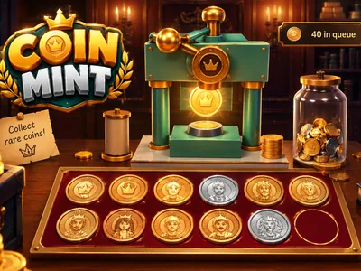
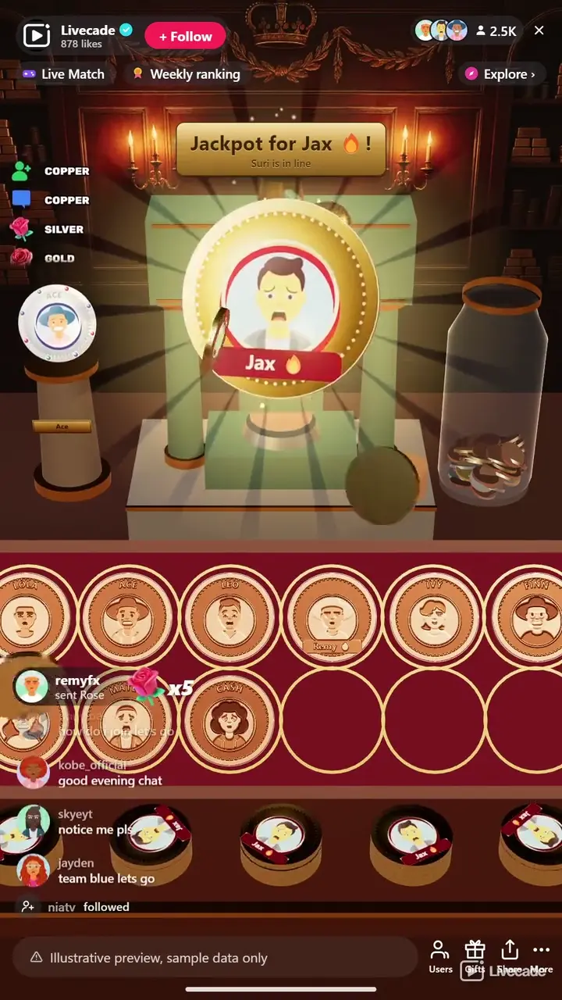

# Coin Mint - Interactive TikTok Live Game

> A coin press on your stream mints a coin with each viewer's face, live.

A coin press on your stream mints a coin with each viewer's face, live. A follow or a comment gets a copper coin, and gifts skip the line for silver, gold, medallions, legendary coins and the jackpot.

**[Play Coin Mint on Livecade](https://livecade.io/games/coin-mint/?utm_source=github&utm_medium=readme&utm_campaign=coin-mint)** - runs as a single browser source in OBS, Streamlabs, or TikTok LIVE Studio. Nothing for viewers to install.

## How viewers play

Viewers take part with the actions TikTok already gives them: **comments**, **follows**, **gifts**, **likes**, **shares**. Every action below is rebindable, so you decide which interaction drives which effect.

| Action | What it does |
| --- | --- |
| **Copper coin** | A copper coin with the viewer's face embossed. From a follow or comment it joins the free line, from a gift it skips it |
| **Silver coin** | An embossed silver coin, ahead of the free line |
| **Gold coin** | A gold coin with the face in colour enamel |
| **Medallion** | Twice the size: the press winds up, slams harder and shakes the camera |
| **Legendary coin** | A gem-set coin that goes on the lit pedestal until the next one, and the board's coins hop |
| **Jackpot** | Held up big with gold rays while 25 gold copies land on the counter, then mounted in the crest |

## How it works

### Follow or comment, get a coin

A follow or any comment puts a viewer in the line, and the press mints a copper coin with their picture struck into it and their name on it.

### Gifts skip the line

A gift mints ahead of the free line, from a Rose's silver coin to a Money Gun's jackpot, and every coin looks and lands differently.

### A board, then the jar

Twelve coins fill the board in front of the press, then it tips them into the jar. A viewer never has two free coins on the same board, so one regular cannot fill it.

### A drum roll for streaks

A copper coin takes under a second at normal speed, and while a long streak of small gift coins is waiting the press speeds up to about four slams a second. Every coin still gets its own slam.

## About the game

Coin Mint puts a coin press on your stream in 3D, in a royal mint hall, a treasure cave or a bank vault. A viewer follows or comments and joins the line. When their turn comes, the press slams down and a coin pops out with their profile picture struck into it and their name on it, then lands face up on the display board in front. Twelve coins fill the board, and then it tips them into a big glass jar behind the press that fills up all stream. A brass plate counts every coin minted this live.

### A better coin for every gift

Out of the box a Rose mints a silver coin ahead of the free line, a Rosa a gold coin with the face in colour enamel, a Doughnut a medallion twice the size that the press winds up for and slams harder, a Hand Heart a gem-set legendary coin that goes on a lit pedestal, and a Money Gun the jackpot. Every unit of a gift with a trigger mints its own coin, streaks included, so 30 Roses are 30 slams of the press.

### The jackpot

A jackpot coin is held up in front of the press at twice its size with gold rays behind it, while the press throws 25 gold copies of the sender's coin onto the counter. Then it takes the frame on the crown of the press and stays there until the next jackpot, and the copies pour into the jar.

### Pedestal and crest

The latest legendary coin stands on its pedestal beside the press with the sender's name on a plate, and the latest jackpot sits in the crest on top of the press, so the biggest gifts of the live stay on screen. When either goes on show, every coin on the board hops.

### Every gift mints

A gift with no trigger of its own still mints by its value: every 500 TikTok coins a jackpot, every 100 a legendary, every 30 a medallion, every 10 a gold coin and a silver coin for each one left, up to 100 silver and gold coins, 5 medallions, 5 legendaries and 2 jackpots from one send. Turn that setting off and only the gifts you bound mint coins.

## What it looks like on stream

[Watch Coin Mint gameplay](https://cdn.livecade.io/games/coin-mint.mp4)

## What you can configure

- **Language** - Thirteen languages for the plates, the queue and the trigger labels
- **Press speed** - Slow, normal or fast. The press also speeds up by itself for long streaks of small coins
- **Other gifts mint by their value** - A gift with no trigger of its own still mints: every 500 TikTok coins a jackpot, every 100 a legendary, every 30 a medallion, every 10 a gold coin, and a silver coin for each one left
- **Scene** - A royal mint hall, a treasure cave or a bank vault, or Custom: your own colour, a transparent background, or an image

## Languages

English, Spanish, Portuguese, French, German, Italian, Indonesian, Arabic, Turkish, Russian, Hindi, Romanian, Filipino

## FAQ

<strong>How do viewers get a coin in Coin Mint?</strong>

Out of the box a follow or any comment puts them in the line for a copper coin. Every trigger can be rebound, so likes, shares or any gift can be the way in instead.

<strong>What is on a viewer's coin?</strong>

Their profile picture, struck into the metal on copper and silver coins and in colour enamel on gold coins and up, with their name on the coin.

<strong>What do gifts do?</strong>

A gift mints ahead of everyone waiting for a free coin. By default a Rose is a silver coin, a Rosa a gold coin, a Doughnut a medallion, a Hand Heart a legendary coin and a Money Gun the jackpot. Every gift with a trigger mints, streaks included, and a gift with no trigger of its own mints by its value in TikTok coins.

<strong>Are the coins worth anything?</strong>

No. They are part of the game on your stream: a picture of the viewer on a coin, kept on the board and in the jar for the live. They are not TikTok coins and cannot be spent or cashed out.

<strong>Does it keep up with a big stream?</strong>

The press mints a copper coin in under a second and speeds up to about four slams a second for long streaks. The free line holds up to 200 viewers, and gifts always go to the front.

<strong>Will Coin Mint run on my PC?</strong>

It renders in 3D on the computer running your stream, so give it a reasonably modern machine. Try it in the dashboard preview before you go live.

<strong>How do I add Coin Mint to my TikTok Live?</strong>

Add one browser source URL to OBS or your streaming software and go live. There is no plugin to install and nothing for your viewers to download.

## Setup

1. [Create a Livecade account](https://app.livecade.io/register?utm_source=github&utm_medium=cta&utm_campaign=coin-mint)
2. Copy your overlay browser source URL
3. Paste it into OBS, Streamlabs, or TikTok LIVE Studio
4. Pick Coin Mint, set your triggers, and go live

Runs in the browser, so it works on Windows and macOS with nothing to download. [See all TikTok Live games](https://livecade.io/tiktok-live-games/?utm_source=github&utm_medium=readme&utm_campaign=coin-mint).

---

_This repository documents Coin Mint, a hosted interactive game by [Livecade](https://livecade.io/?utm_source=github&utm_medium=footer&utm_campaign=coin-mint). The game runs on Livecade's platform, so there is no source to install here._
